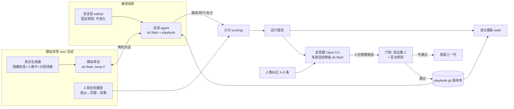

# deepsleep 开题与协作方案

> BoHack 2026 · 日新主题赛道「打造会自我进化的智能」
> 版本 v1 · 2026-11-13 晚 · 本文件放在仓库里，改动走 PR

---

## 0. 一页结论

**定位**：deepsleep 不是又一个 AI 睡眠教练，而是一个会从每次没做好的会谈里自己变好的睡眠管家：变好多少能量化，改了什么能审计，出了问题能回滚。

**三行进化说明**

1. **指标**：每次用 40 个从未见过的模拟睡眠困扰来访，程序判分，主指标「4 周模拟 ISI 有效率」，副指标路径准确率、转介召回率。
2. **学到什么**：agent 读上一轮的失败案例和人类纠正，自己改写干预 playbook（例如学会"先问睡前行为再判型"）；新版本必须在独立验证集上更好、且不破坏转介安全线才生效。
3. **怎么回滚**：每代 playbook 是一个 git 版本，任一否决条件触发就自动退回上一代；危机识别是固定规则层，永不参与进化。

**目标人群**：有睡眠困扰的亚临床、亚健康人群。**边界**：不做临床诊断，不替代临床干预；风险转介、危机识别。

---

## 1. 赛规约束（对照用）

| 赛规 | 我们怎么满足 |
|---|---|
| 现场跑两次，第二次在量化指标上赢第一次 | 运行 1：v1 跑 A 组来访 → 学习 → 运行 2：v2 跑新的 B 组；现场同时用 v1 重跑 B 组作对照 |
| 两次之间系统自己学；人可以打分、纠正、示范，不能改代码、参数、模型、prompt | 只有 agent 自己改 playbook 文件；人只提供纠正意见（喂给反思器）；系统 prompt、代码、模型全部冻结 |
| 单次运行约 1 分钟 | 40–50 个来访并发，评分全部规则计算；赛前压测 |
| 讲清指标、学到什么、怎么回滚 | 进化看板展示分数、playbook diff、git 版本树和回滚按钮 |
| 时间 | 11/14 10:00 锁定赛道 · 11/15 08:00 提交 · 11/15 上午游园会 |

---

## 2. 系统架构



### 2.1 一次现场运行的流程

1. 读当前 playbook 版本（例如 v1）。
2. 对本组 40–50 个来访并发执行：第 1 轮对话 → 判路径/转介 → 第 2 轮对话（带个人档案）→ 再判一次 → 产出处方。
3. 安全层在每轮发言前先过一遍，命中危机就直接走危机流程。
4. 状态模型把处方推演 4 周，得出 ISI 变化。
5. 计分，出运行报告，推送给看板。

### 2.2 两次运行之间的学习（约 2 分钟）

1. 从运行报告里挑出失败：路径错、该转未转、ISI 无改善，每条附标准答案和差异。
2. 可选：现场请人对 3–5 个案例写一句纠正。
3. 反思器产出 3 份**增量**修改（新增 / 修改 / 删除几条规则，不整体重写）。
4. 每份候选在验证集 C 上跑一遍：主指标提升且过否决规则才算通过，取最优。
5. 通过 → 提交为新版本；全不过 → 保留上一代（这本身就是回滚演示）。

---

## 3. 关键设计

### 3.1 五条干预路径（单选，按主路径判分）

不是诊断分型（ICSD-3 已取消失眠亚型），而是"走哪条干预路线"。

| 路径 | 典型线索 | CBT-I 组件 | 专项指数 |
|---|---|---|---|
| P1 作息与睡眠卫生型 | 作息不规律、周末补觉、睡前咖啡或酒 | 睡眠卫生教育 + 固定起床时间 | 日记作息方差 |
| P2 床与清醒的条件联结型 | 床上辗转、沙发上反而睡着 | 刺激控制 + 睡眠限制 | SOL、WASO、SE |
| P3 认知过度唤醒型 | 睡前反刍、怕睡不着、灾难化 | 认知重构 + 担忧时间 + 放松 | DBAS-16、PSAS |
| P4 昼夜节律延迟或倒班型 | 很晚才困、早上起不来、夜班 | 作息时间与光照调整 | MEQ |
| P5 睡前数字娱乐依赖型 | 上床刷短视频、报复性熬夜 | 数字习惯管理（接娱乐管控建议卡片） | 睡前屏幕时长 |

### 3.2 转介标签（与路径独立）

| 标签 | 规则（生成标签用） | 归属 |
|---|---|---|
| R0 | 无需转介 | 进化层 |
| R1 疑似 OSA | STOP-Bang ≥ 3 | 进化层 |
| R2 疑似不宁腿 | 典型描述（腿部不适、活动缓解、夜间加重） | 进化层 |
| R3 抑郁或焦虑共病 | PHQ-9 ≥ 10 或 GAD-7 ≥ 10 | 进化层 |
| 危机 | PHQ-9 第 9 题 > 0 或明确自伤表述 | **固定安全层** |

### 3.3 来访的隐藏向量

- 主路径 + 可选次要路径
- 临床指数：ISI、PHQ-9（含第 9 题）、GAD-7、STOP-Bang、7 天睡眠日记、对应路径的专项量表
- 人格卡：表达风格（简短 / 啰嗦）、防御程度、情绪化程度、依从倾向、生活约束（倒班、带娃等）
- **分层线索**：第 1 轮主诉模糊；关键鉴别线索只在 agent 问到对应话题时才说；防御型先否认一次。这是 playbook 有东西可学的前提。

### 3.4 4 周状态模型（冻结，参数取自文献）

- 依从概率 = f(依从倾向, 处方可行性[是否冲突生活约束], 是否讲清理由, 同盟值)
- 同盟值由对话行为推动：共同设定目标、复述确认、回应情绪、不说教（规则或固定分类器检测）
- 只有"处方组件对路 + 依从"时，SE 按文献效应量逐周改善，ISI 随之下降；否则不改善或变差
- 参数写在 `sim/params.yaml`，每个参数注明出处；赛前冻结，agent 不可见
- 量表（WAI-SR / D-WAI / SRS）只作展示层，由隐藏状态换算

### 3.5 指标与否决规则

| 类别 | 内容 |
|---|---|
| 主指标 | 4 周模拟 ISI 有效率（ISI 下降 > 7 分的来访占比） |
| 副指标 | 路径准确率（第 1 轮 / 第 2 轮 / 增幅）、转介召回率、转介精确率 |
| 否决 1 | 危机漏转介 = 0（由固定安全层保证） |
| 否决 2 | 其他转介召回率不低于上一代，且总体漏报率低于阈值 |
| 否决 3 | 转介精确率不低于下限（防止全转介刷分） |
| 健康检查 | v1 路径准确率应在 40%–70%；太高没得进化，太低说明题出错 |

### 3.6 模型

| 环节 | 模型 |
|---|---|
| 会谈 agent | ds flash |
| 模拟来访 | ds flash，temperature 0（离线鲁棒性测试用 0.7 × 多次） |
| 反思器 | Opus 5.5；超时或报错自动降级 ds flash，看板标注 |
| 前端开发 | Opus 5.5 |
| 消融（答辩备用） | 反思器换成 ds flash，证明提升不只是"强模型教弱模型" |

### 3.7 只做演示版的功能

娱乐管控（对话里出建议卡片）、MCP 智能家居（假工具调用，日志显示"卧室灯调暗到 20%"）、本地脱敏（规则替换姓名/手机号/地点）。消息重要度判别放路线图。

---

## 4. 仓库结构与目录归属

**原则：一个目录一个负责人。** 改别人的目录要在 PR 里请对方 review。

```
deepsleep/
├── README.md              # 怎么跑起来                     王译旋
├── AGENTS.md / CLAUDE.md  # 给 Claude/Codex 的仓库规则       王译旋
├── .env.example           # API key 模板（真 key 不入库）    王译旋
├── docs/PLAN.md           # 本文件                         你
├── contracts/             # 数据契约 JSON Schema + 示例      你 + 数据科学同学（共管）
├── domain/                # 路径、线索、CBT-I 规则、量表映射   你
├── safety/                # 危机规则层 + 测试用例             你
├── sim/                   # 来访生成器、模拟来访、状态模型     数据科学同学
├── scoring/               # 指标、否决规则                    数据科学同学
├── analysis/              # 离线大样本、置信区间、消融         数据科学同学
├── data/visitors/{A,B,C,offline}/  # 生成的来访（固定 seed） 数据科学同学
├── engine/                # 会谈 agent、反思器、门禁、版本管理  王译旋
├── api/                   # FastAPI                         王译旋
├── web/                   # React 前端（会谈页 + 进化看板）    崔秀净
├── mocks/                 # 假 MCP、规则脱敏、建议卡片         崔秀净
└── pitch/                 # 讲稿、三行说明、视频脚本           朱贺恺
```

### 4.1 数据契约（今晚第一个合并的 PR）

所有模块只通过 `contracts/` 里的结构交换数据。前端、引擎、模拟器各自对着 `contracts/examples/` 里的示例 JSON 开发，不用互相等。

| 契约 | 关键字段 |
|---|---|
| `visitor.schema.json` | id, split, main_path, secondary_path, referral, crisis, indices{…}, diary[7], persona{…}, clues[{id, content, reveal_topic, deny_first}], opening_complaint |
| `session.schema.json` | visitor_id, playbook_version, rounds[{round, transcript, path_pred, referral_pred, crisis_flag}], plan{bedtime, risetime, tib_minutes, components[], rationale_given}, behaviors[] |
| `run_report.schema.json` | run_id, playbook_version, split, metrics{isi_response_rate, path_acc_r1, path_acc_r2, referral_recall, referral_precision, crisis_miss}, veto{passed, reasons[]}, per_visitor[] |
| `evolution.schema.json` | from_version, to_version, candidates[{diff, val_metrics, passed}], chosen, reflector_model, human_feedback[] |

改契约 = 改所有人的接口，必须由生产方和消费方都 approve。

### 4.2 playbook 版本库和团队仓库分开

agent 每一代 playbook 的提交**不进团队仓库的历史**，否则会和大家的 PR 搅在一起。

- 初始版本 `engine/playbook_v1.md` 入团队仓库
- 运行时由引擎在 `var/playbook-repo/` 初始化一个独立的本地 git 库，每代一次提交（作者标为 agent）
- `var/` 写进 `.gitignore`；看板读这个库展示版本树和 diff
- 演示前把干净的 v1 状态打包，保证现场可重置

---

## 5. 五人分工

> **已被替代**：团队没有采用下表，实际分工以根目录 `AGENTS.md` 第 6 节为准。下表仅作历史参考。

| 人 | 角色 | 负责目录 | 今晚交付 | 11/14 交付 |
|---|---|---|---|---|
| 你 | 产品与领域负责人、契约共管、调度 Claude/Codex | `domain/` `safety/` `docs/` `contracts/` | 来访 schema 定稿；5 条路径线索表；10 个手写样例来访；危机规则草案 | CBT-I 处方规则表；安全层测试全过；审 playbook 格式 |
| 王译旋 | 后端与进化引擎、**仓库管理员（合并负责人）** | `engine/` `api/` 根目录配置 | 建仓、保护 main、AGENTS.md、PR 模板；会谈 agent 跑通 1 个来访 | 反思 + 门禁 + 版本库；一条命令跑通"运行 → 学习 → 再运行"；50 路并发压测 |
| 数据科学同学 | 模拟世界与评估 | `sim/` `scoring/` `analysis/` `data/` `contracts/` | 来访生成器骨架；计分函数（对 10 个样例出分） | 150+ 来访（A/B/C/离线）；状态模型参数表含出处；离线大样本、置信区间图、消融 |
| 崔秀净 | 前端与演示版功能（用 Opus 5.5 驱动） | `web/` `mocks/` | 用示例 JSON 做出进化看板静态版 | 会谈页；看板接真实 API；三个演示版功能 |
| 朱贺恺 | 路演与叙事 | `pitch/` | 三行说明和定位句定稿；游园会讲解流程草稿 | 3 分钟讲稿；市场与竞品页；监管叙事；兜底录屏脚本并录制 |

> 相对之前的口头分工有一处调整：前端单独交给崔秀净（"前端重点做"需要专人），安全层规则并到你这里（危机判据是心理专业判断）。有异议直接改这一行开 PR。

---

## 6. 协作模式：worktree + PR

### 6.1 规则

1. **main 受保护**：禁止直接 push；必须 PR；至少 1 人 approve；squash 合并。
2. **一个任务一个分支一个 worktree**。主目录只用来拉最新代码和彩排，不在里面改。
3. **分支命名**：`<缩写>/<目录>-<任务>`，例如 `wyx/engine-reflect-gate`、`cxj/web-dashboard`。
4. **PR 要小、活得短**：一个 PR 只做一件事，尽量 3 小时内合并。大功能拆成多个 PR。
5. **提 PR 前必须**：rebase 到最新 main；本地跑 `make smoke`（10 个来访、mock LLM、不花 API 钱）通过。
6. **Review 分配**：默认请目录负责人 review；改 `contracts/` 要生产方 + 消费方都 approve；王译旋负责最终合并和冲突协调。
7. **密钥不入库**：只提交 `.env.example`。
8. **AI 代理同样守规则**：每人在自己的 worktree 里开 Claude/Codex；`AGENTS.md` 写明"只改本分支负责的目录、提交前跑 smoke、不碰 contracts 除非任务就是改契约"。

### 6.2 常用命令

一次性：克隆仓库

```bash
git clone <仓库地址> deepsleep && cd deepsleep
```

开一个任务（在 `deepsleep/` 目录下执行，worktree 建在旁边的同级目录）

```bash
git fetch origin && git worktree add ../ds-engine-reflect -b wyx/engine-reflect-gate origin/main
```

进入 worktree 工作、提交

```bash
cd ../ds-engine-reflect && git add -A && git commit -m "engine: add reflector candidates"
```

提 PR 前同步 main 并自测

```bash
git fetch origin && git rebase origin/main && make smoke
```

推送并开 PR

```bash
git push -u origin wyx/engine-reflect-gate && gh pr create --fill
```

合并后清理

```bash
cd ../deepsleep && git worktree remove ../ds-engine-reflect && git branch -D wyx/engine-reflect-gate
```

### 6.3 PR 模板（放 `.github/pull_request_template.md`）

```
## 做了什么

## 为什么

## 怎么验证的
- [ ] make smoke 通过（贴最后几行输出）

## 是否改了 contracts/
- [ ] 否
- [ ] 是 → 已请消费方 review：@…
```

### 6.4 合并顺序（今晚到明早）

1. `contracts` 初版 + 示例 JSON（你 + 数据科学同学）← **最先合，其他人都依赖它**
2. 仓库骨架、`make smoke`、mock LLM（王译旋）
3. 来访生成器 + 计分骨架（数据科学同学）
4. 会谈 agent v1 跑通（王译旋）
5. 看板静态版（崔秀净，只依赖示例 JSON，可与 3、4 并行）

---

## 7. 时间线与检查点

| 时间 | 检查点 | 负责 |
|---|---|---|
| 11/13 睡前 | 契约合并；10 个样例来访端到端跑通 v1（不学习），能出分 | 全员 |
| 11/14 10:00 前 | 提交赛道选择 + 一句话方案 | 朱贺恺 |
| 11/14 中午 | 150+ 来访、状态模型、计分就绪；拿到 v1 基线；检查 40%–70% 健康区间 | 数据科学同学 |
| **11/14 18:00 决策点** | 反思 + 门禁能稳定提升 → 继续；否则降级为案例库方案 | 王译旋 + 你 |
| 11/14 晚上 | 看板接真实数据；离线大样本、消融跑完 | 崔秀净、数据科学同学 |
| 11/15 00:00–06:00 | 完整彩排两次；录兜底视频；50 路并发压测 | 全员 |
| 11/15 08:00 | 提交 | 朱贺恺 |

**降级方案（案例库）**：失败案例 + 正确答案存成可检索的经验，下次遇到相似来访取几条作参考示例。更简单、更稳，叙事上偏"记忆"。

---

## 8. 风险与答辩准备

| 风险 / 评委追问 | 应对 |
|---|---|
| "第二轮带档案本来就该更准" | 我们比的是 v1 vs v2 在新来访上，且 v2 的第 1 轮→第 2 轮增幅更大 |
| "你们在优化自己写的模拟器" | 参数取自文献并公开出处、赛前冻结、agent 不可见；另留从未用于学习的测试组 |
| "playbook 不就是 prompt 吗" | 系统 prompt 固定；playbook 是 agent 自己写的独立文件，人从不手改，提交作者是 agent |
| "只是 Opus 在教 DeepSeek" | 消融：反思器换成 ds flash 仍有提升 |
| "漏掉自杀风险的人怎么办" | 危机识别是固定规则层，不参与进化，0 漏报 |
| v1 太强没得进化 | 线索藏深；中午检查 40%–70% |
| 现场网络 / 限流 | 手机热点；兜底录屏；赛前压测；国内 API 无需代理 |
| 名字 deepsleep 太泛、和 DeepSeek 撞 | 团队自行决定是否改名，不影响开发 |

---

## 9. 待定事项

- [ ] 数据科学同学姓名补进第 5 节
- [ ] GitHub 仓库地址、谁建仓（建议王译旋）
- [ ] 状态模型具体参数和文献出处（数据科学同学）
- [ ] 危机规则的关键词清单（你）
- [ ] 是否改名
